<p align="center">
  
</p>

<h1 align="center">Firewall Rule Drift Detector</h1>

<p align="center">
  Scores network flows for firewall rule drift, ranks them by severity and explains why.
</p>

<p align="center">
  <a href="https://firewall-rule-drift-detector.onrender.com"></a>
  
  
  
</p>

A Flask web application for the research project **"Firewall Rule Drift Detection Using a
Hybrid Semi-Supervised Machine Learning Framework with SHAP Explainability"**
(NMAM Institute of Technology, Department of Cyber Security).

It runs the project's **Tuned Random Forest**, trained on the UNSW-NB15 dataset, and scores
each network flow with a drift probability and a severity tier. With SHAP installed, every
score also comes with an explanation.

> **Try it:** <https://firewall-rule-drift-detector.onrender.com>
> The demo runs on a free plan, so the first visit after a quiet period can take up to a
> minute to wake up. The hosted demo runs without live SHAP explanations (see
> [Hosted demo](#hosted-demo)); SHAP runs when you install it locally.

<!-- Add a screenshot or short GIF of the Detect page here, for example:
 -->

---

## Contents

- [What it detects](#what-it-detects)
- [Features](#features)
- [Results](#results)
- [Run it locally](#run-it-locally)
- [Hosted demo](#hosted-demo)
- [CSV format for uploads](#csv-format-for-uploads)
- [API](#api)
- [Project structure](#project-structure)
- [Rebuilding the artifacts](#rebuilding-the-artifacts)
- [How scoring works](#how-scoring-works)
- [Limits](#limits)
- [How I built this with AI](#how-i-built-this-with-ai)
- [Data and credits](#data-and-credits)

---

## What it detects

No public dataset pairs firewall rule-bases with the traffic they let through, so drift is
detected through its symptom. A correctly maintained firewall should block reconnaissance,
exploits, denial-of-service and other malicious flows. When such traffic is seen on the
network, the effective rules have drifted from the intended policy: a rule is too broad, a
temporary exception was never closed, or a port was opened by mistake.

Each flow gets a **drift probability**, which is mapped to a severity tier:

| Tier | Drift probability | Recommended action |
|---|---|---|
| Low | below 30% | Monitor only |
| Medium | 30–60% | Investigate |
| High | 60–80% | Alert |
| Critical | above 80% | Immediate action |

The model shows that a flow should have been blocked. Finding the rule that let it
through still needs the firewall log.

---

## Features

| Page | What it does |
|---|---|
| **Home** | Live demo: scores random held-out test flows with the real model |
| **Detect** | Score one flow by hand, or load a real normal or attack example in one click. With SHAP installed, each score comes with an exact feature breakdown |
| **Upload CSV** | Score a whole file of flows. The report shows flows per tier, a score histogram, accuracy and per-category detection when the file has labels, and is downloadable as JSON. With SHAP installed it also shows the features that drove the scores and a "why" for each top flow |
| **Results** | The paper's results as charts: model comparison, confusion matrix, SHAP, severity tiers, attack categories, CIC-IDS2017 |
| **Method** | Drift definition, data, model, explanations and limits |
| **API** | `POST /api/predict`: JSON in, drift probability and tier out |

---

## Results

UNSW-NB15 test set, 35,069 flows.

| Model | Accuracy | F1 | AUC |
|---|---|---|---|
| **Tuned Random Forest** (used by this app) | **96.06%** | **97.12%** | **0.9938** |
| XGBoost | 95.48% | 96.71% | 0.9924 |
| LSTM | 94.47% | 95.98% | 0.9896 |
| KNN (baseline) | 93.84% | 95.51% | 0.9757 |
| Isolation Forest (trained without attack labels) | 75.89% | 81.84% | 0.8279 |

- False-negative rate **2.44%** and false-positive rate **7.13%** at the 0.50 threshold
- **99.2%** of flows scored Critical are real attacks; only **1.7%** of Low flows are
- SHAP: time-to-live features (`sttl`, `ct_state_ttl`, `dttl`) dominate the decisions

---

## Run it locally

The repository already contains the trained model in compressed form (`artifacts/`), so
**the dataset is not needed to run the site**.

**Requirements:** Python 3.13. The versions in `requirements.txt` are pinned to the ones
that trained the model, because a scikit-learn model must be loaded with the same version.

**Windows**

```bat
git clone https://github.com/Advithrai/Firewall-rule-drift-detector.git
cd Firewall-rule-drift-detector
python -m venv .venv
.venv\Scripts\activate
pip install -r requirements.txt
python app.py
```

**macOS / Linux**

```bash
git clone https://github.com/Advithrai/Firewall-rule-drift-detector.git
cd Firewall-rule-drift-detector
python3 -m venv .venv
source .venv/bin/activate
pip install -r requirements.txt
python app.py
```

Open **http://127.0.0.1:5000**. Start-up takes a few seconds while the model loads.

### Enabling SHAP explanations

`requirements.txt` leaves SHAP out so the app fits small hosting plans. To turn on the
per-flow explanations, install it too:

```bash
pip install shap==0.51.0
```

| Setup | RAM needed |
|---|---|
| Without SHAP (default) | about 420 MB |
| With SHAP | about 650 MB |

Without SHAP the site still works and scores every flow. It only skips the explanations.

---

## Hosted demo

The live demo runs on [Render](https://render.com)'s free plan (512 MB RAM) from the
included `Dockerfile`. To deploy your own copy:

1. Fork or clone this repository to your GitHub account.
2. On Render choose **New → Web Service** and select the repository.
3. Set the runtime to **Docker** and the instance type to **Free**, then deploy.

Notes:

- The container listens on the `PORT` that Render provides and runs a single gunicorn
  worker, so uploaded reports stay in one process.
- Free services sleep when idle, so the first request afterward is slow.
- The default `requirements.txt` has no SHAP, to stay under 512 MB. For live explanations
  use a plan with at least 1 GB of RAM and add `shap==0.51.0` to `requirements.txt`.

The same `Dockerfile` works on any Docker host.

---

## CSV format for uploads

Each row is one network flow in UNSW-NB15 format. The **Detect** page has the full guide
and a downloadable template.

- **Required:** the 42 UNSW-NB15 feature columns, with exact names, in any order. `proto`,
  `service` and `state` are text values seen in UNSW-NB15; everything else is numeric with
  no empty cells.
- **Optional:** `label` (0 = normal, 1 = attack) adds accuracy, precision, recall and a
  confusion matrix to the report. Adding `attack_cat` as well gives detection per category.
- **Ignored:** `id` and any other extra columns.
- Up to 200,000 rows per file. On a small hosting plan, use smaller files.

The official UNSW-NB15 training and testing CSVs can be uploaded as they are.

---

## API

```bash
curl -X POST https://firewall-rule-drift-detector.onrender.com/api/predict \
  -H "Content-Type: application/json" \
  -d '[{"proto": "tcp", "service": "http", "state": "INT", "sttl": 254}]'
```

For a local copy, use `http://127.0.0.1:5000/api/predict` instead.

Fields you leave out take the training median. The response gives the drift
probability, tier and recommended action for each flow.

---

## Project structure

```
app.py                  Flask app: preprocessing, scoring, SHAP, pages and API
artifacts/
  rf_model.joblib         Tuned Random Forest (compressed)
  drift_artifacts.joblib  Encoders, scaler, medians and 4,000 held-out test flows
templates/              HTML pages
static/                 Stylesheet and bundled Archivo font
export_artifacts.py     Rebuilds artifacts/ from the dataset and the original model
make_sample_csv.py      Creates demo CSVs from the dataset for the upload page
Dockerfile              Container setup (used for the Render deployment)
requirements.txt        Pinned library versions
```

---

## Rebuilding the artifacts

Only needed if the model is retrained. With the UNSW-NB15 training CSV and the original
`rf_tuned_model.pkl` on the machine (paths at the top of `app.py`, or the environment
variables `DRIFT_RAW_CSV` and `DRIFT_MODEL`):

```bash
python export_artifacts.py
```

This rewrites `artifacts/`, checks that the exported model scores exactly like the
original, and pins `requirements.txt` and the `Dockerfile` to the current environment.

> Re-running this script rewrites `requirements.txt` and the `Dockerfile`. If you host on a
> small plan, check afterward that SHAP is not back in `requirements.txt` and that the
> `Dockerfile` still starts gunicorn on `${PORT:-7860}`.

---

## How scoring works

1. The flow's 42 features are prepared exactly as in training: `proto`, `service` and
   `state` are label-encoded, and every feature is standardised.
2. The Tuned Random Forest (200 trees, `min_samples_split=5`, `class_weight='balanced'`)
   returns the probability that the flow is traffic a correct policy would block.
3. The probability is mapped to a severity tier.
4. If SHAP is installed, it splits the score into a contribution from each feature. A
   single flow uses exact Tree SHAP; uploaded files use the fast approximate version so
   large files stay quick.

---

## Limits

- Trained offline on a benchmark; real traffic changes over time and needs periodic retraining.
- Expects flow-level features. Raw packet captures must first pass through a flow exporter
  such as CICFlowMeter or Argus.
- Uploaded reports are kept in memory and are lost when the app restarts.
- The free hosted demo sleeps when idle and has no live SHAP explanations.

---

## How I built this with AI

- **Tools:** Claude
- **What I directed:** the research design (detecting drift through its symptom), the model choice (Tuned Random Forest), the severity tiers, and the decision to ship the hosted demo without SHAP so it fits the free 512 MB plan.
- **What the AI helped write:** [e.g. Flask routes, HTML templates, Dockerfile]
- **A problem I caught:** [one thing that really happened, e.g. a scikit-learn model only loads with the version that trained it, so I pinned requirements.txt; or SHAP pushed memory past the free plan, so I made it optional]
- **How I tested it:** [e.g. checked the exported model scores exactly like the original, tried malformed CSVs, called /api/predict with curl]

---

## Data and credits

- Dataset: N. Moustafa and J. Slay, "UNSW-NB15: A comprehensive data set for network
  intrusion detection systems," MilCIS, IEEE, 2015. The dataset itself is not included in
  this repository.
- Font: Archivo, SIL Open Font License (`static/fonts/OFL-LICENSE.txt`).
